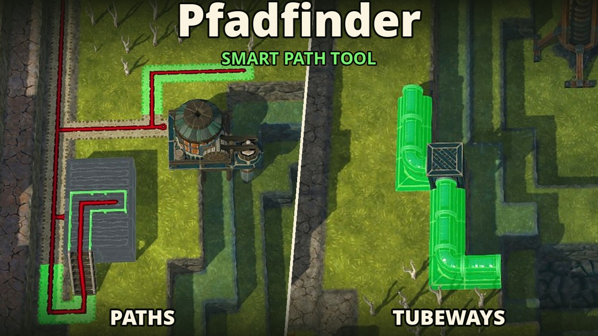

# Pfadfinder (smart path tool) Timberborn mod



Drag a path from one tile to another and it routes around trees, buildings, rubble, cliffs and
anything else you can't build on, instead of drawing the vanilla straight L.

> **Disclaimer: this mod is AI coded.** It was written largely by an AI coding assistant (Claude), not hand-written and reviewed.
> It's play-tested and code reviewed but not exhaustively.

- Works with the Path, Tubeway and Vertical Tubeway tools, in game and map editor. No new buttons.
- A clear vanilla L stays the vanilla L. Routes prefer few turns.
- Existing paths (tubes, for tubeways), bridges, gates and airlocks are reused, in the directions
  they can actually be walked.
- Drag to another height level and the route uses existing stairs (or vertical tubeways). No new
  stairs are built.
- Goes under platforms and overhangs, over stumps and dead bushes.
- No route found: you see the vanilla L. Routes stop at the tool's 40-tile preview limit, like vanilla.

## Settings

Needs the **Mod Settings** mod (`eMka.ModSettings`):

- **Hold Alt to route** (off): swap Alt's role — drags are vanilla, Alt routes.
- **Route across levels** (on): use the height level the cursor points at, via existing stairs.
- **Route tubeways** (on): route the tubeway tools too.
- **Hide build range while routing** (off): skip the district range overlay for routed drags.

## How it works

A Harmony prefix on `AreaPicker.PickBlockObjectArea` wraps the path tool's preview and action
callbacks, so the game still does input, previews, validation, unlocking and placing; only the list
of tiles is replaced. For each drag:

1. The ends are the drag start and the far end of the vanilla L — or, across levels, the tile under
   the cursor (end ray captured from `AreaPicker.GetBlocks`).
2. A* runs between them (turn penalty, existing pieces cheap, vanilla L slightly preferred). A step
   needs both tiles to allow its direction.
3. Each tile is checked once per drag, at most 1,500 per frame (a click finishes the search):
   - **existing** if its Path-slot object has a `PathSpec` and matches the tool (tube or not). The
     walkable directions come from the object's navigation edges (`BlockObjectNavMeshSettingsSpec`,
     read by reflection), so stairs link levels and bridges/gates are one-axis. Zipline towers have a
     `PathSpec` but no edges, and buildings with an entrance (district center, tubeway and zipline
     stations) are entered through their door, not walked across, so they're all obstacles;
   - otherwise **free** if a hidden preview of the piece passes `BlockObject.IsValid()`, the same
     check the tool's own previews use.

Source: `GridRouter` (pure A*), `RoutingService` (tile checks, placements), `NavEdgeReader`,
`PathToolPatch`, `RangeOverlayPatch`, `PfadfinderSettings`, `ModStarter` — all in `src/`.
Search tuning (`Margin`, costs, budget) is at the top of `GridRouter.cs`.

## Build

Needs Timberborn 1.1+, the **Harmony** and **Mod Settings** workshop mods (subscribed, so their DLLs
are on disk) and the .NET SDK 6+. The build deploys `Pfadfinder.dll` and `manifest.json` to
`Documents/Timberborn/Mods/Pfadfinder/`; then enable the mod (with Harmony and Mod Settings).

```bash
dotnet build -c Release                                          # default Steam location (Windows)
dotnet build -c Release -p:SteamDir="D:\SteamLibrary\steamapps"  # other library
```

Linux (Steam + Proton; Flatpak: `STEAM=~/.var/app/com.valvesoftware.Steam/.local/share/Steam/steamapps`):

```bash
STEAM=~/.steam/steam/steamapps
dotnet build -c Release \
  -p:ManagedDir="$STEAM/common/Timberborn/Timberborn_Data/Managed" \
  -p:HarmonyDll="$STEAM/workshop/content/1062090/3284904751/0Harmony.dll" \
  -p:ModSettingsDir="$STEAM/workshop/content/1062090/3283831040/version-1.1/Scripts" \
  -p:ModOutputDir="$STEAM/compatdata/1062090/pfx/drive_c/users/steamuser/Documents/Timberborn/Mods/Pfadfinder"
```

macOS: pass `ManagedDir` as `Timberborn.app/Contents/Resources/Data/Managed`.

## Troubleshooting

`Player.log` lines start with `[Pfadfinder]` (Windows: `%USERPROFILE%\AppData\LocalLow\Mechanistry\Timberborn\`,
Linux/Proton: `$STEAM/compatdata/1062090/pfx/drive_c/users/steamuser/AppData/LocalLow/Mechanistry/Timberborn/`).

- *"Failed to apply patches"* — a game update changed the patched code; the mod is inactive and the
  vanilla tools work as before.
- *"Routing failed, falling back…"* — logged once; that drag uses vanilla.
- Compile errors after a game update usually name a type that moved; fix the `using` line.

## Ideas for later

- Place new stairs where a route needs to change level.
- Avoid water / prefer dry tiles.
